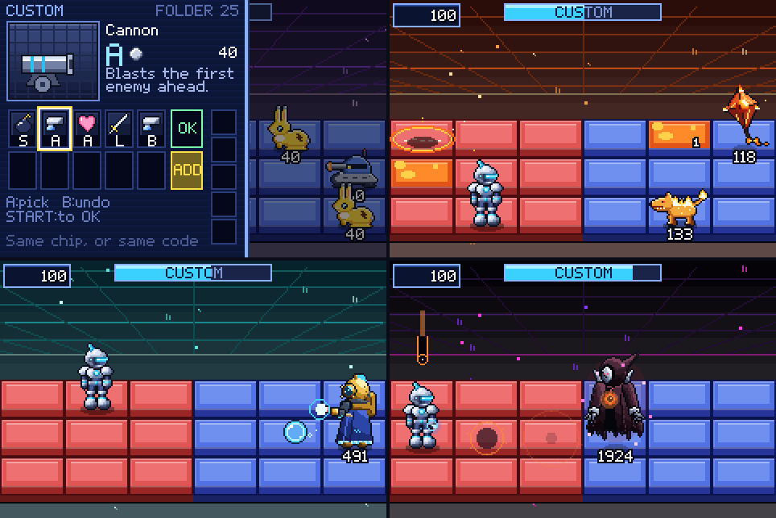

# CyberMetal GridWars

A fights-only, real-time grid battler for the browser: a clean-room recreation of the **battle system of
Mega Man Battle Network 3**, with no overworld and no story. You get straight into battles: 6x3 grid
duels against viruses and boss navis, a chip folder, the Custom Screen, and Program Advance–style fusions.



Every character, sprite, sound and tune is original. The *rules* are rebuilt from the game itself: chip
damage, codes, MB, elements and rarity, virus/boss HP and elements, and the starter-folder shape were read
from the owner's own BN3 ROM. None of the ROM's bytes ship in this repo.

## New: open-world prototype

The next direction for the project: the same kind of fights, taken off the grid into a 3D world (think
Palworld's open landscapes, with Mega Man X-style shooting). Viruses are leaking out of the net into the
real world; find the six rifts, blast what comes out and seal them.

- **Run it:** `npm install`, `npm run serve`, then open http://127.0.0.1:8123/world/. Or `npm run build` and
  open `dist/world.html` (one file, works offline). Add `?auto=1` to watch the demo pilot play.
- **Controls:**
  - **Keyboard and mouse:**
    - WASD to move (the camera decides forward), mouse to aim (click locks the mouse).
    - Click or J to blast: hold, then release for a charge shot.
    - Space to jump, Shift to dash (invincible mid-dash), Q/E to turn the camera, wheel to zoom.
  - **Gamepad:** sticks, A to jump, B to dash, X or RT to blast.
  - **Touch:** a stick, drag to look, and buttons.
  - **F3** shows the frame rate.
- **What's in it:**
  - **Your mech:** the rigged model you made, animated in code (idle, run, jump, dash, aim, recoil, hurt).
  - **The world:** a seeded landscape with lakes, a forest, wind-blown grass and a mountain rim.
  - **Enemies:** three viruses from the grid game, each with a telegraphed attack you can counter by
    hitting it during the wind-up:
    - Rivet slams the ground and sends out a shockwave you jump over;
    - Plinker aims a laser, then fires a cannonball;
    - Dartfin marks a line on the ground and dives along it.
  - **Rewards:** data drops that heal you.
  - **Progression:** six rifts; sealing all six starts a tougher wave.
  - **HUD:** a rotating minimap, damage numbers and the grid game's synth sounds and music.
- **How it's built:** like the grid game, a deterministic 60 Hz simulation (`src/world/sim.js`, no
  rendering) is drawn by a separate view (`src/world/view.js`, three.js r186 on WebGL2). The simulation
  has its own tests (`tests/world.test.js`) and a headless bot plays it for balance checks.
- **The model:** `assets/mecha.glb` was generated by the project owner with Tripo AI. Tripo's export had
  a broken skeleton (every bone at the origin, garbage bind matrices); `tools/repair_glb.py` rebuilds
  the joints from the skin weights and slims the texture. Tripo's terms decide commercial use: free-plan
  models may not be usable commercially.

## Play (grid battler)

- **No install:** run `npm run build`, then open `dist/cybermetal-gridwars.html` in any modern browser.
  It's one self-contained file and works offline from `file://`.
- **Dev server:** `npm run serve`, then open http://127.0.0.1:8123/. It serves plain ES modules, so there
  is no build step.

### Controls
| | Keyboard | Gamepad | Touch |
|---|---|---|---|
| Move | Arrows / WASD | D-pad / stick | D-pad |
| Buster (hold to charge) | Z or J | B / X | B |
| Use chip / confirm | X or K | A / Y | A |
| Open Custom Screen (gauge full) | Q / E / Shift | LB / RB / triggers | L / R |
| Pause (SELECT in pause = retreat) | Enter | Start | START |
| Shield (Shield style) | Back + Z | Back + B | Back + B |

## What's in it

**Modes**
- **Gauntlet:** eight areas. Each has three designed virus battles, then a boss duel. HP carries between
  an area's battles; losing resets the area. Each boss's first defeat gives its Navi chip, a stat or
  program, and +80 max HP.
- **Free Battle:** replay any battle you've reached, rematch bosses at V2, V3 and Ω, or roll a random
  mixed battle.
- **Folder:** edit your 30-chip folder from everything you've won. BN-style limits apply.
- **Chip Shop:** spend the Bits that battles drop on chips from the areas you've reached, or on HP Memory.
- **Programs:** equip passive parts (SuperArmor, UnderShirt, FloatShoes, AirShoes, Custom+1/+2) within a
  memory budget, a light take on BN3's Navi Customizer.
- **Style Change:** beating bosses unlocks styles, and you can wear one type and one element at a time.
  - Types: Guts (double buster, no flinch), Custom (+1 chip on the Custom Screen), Shield (Back+B
    reflects) and Team (+2 Mega chips).
  - Elements: Heat, Aqua, Elec and Wood. Each changes your body's element and your charge shot.
- **How to Play:** six short pages in the title menu covering the rules.

**The battle system**, recreated:
- **Field:** a 6x3 grid. Red area vs blue area, with ownership that moves: AreaGrab/PanlGrab steal panels,
  which return after a while.
- **Panels:** normal, cracked (breaks when you step off), broken (recovers later), grass (Fire ×2 and
  burns away; Wood bodies regenerate on it), ice (you slide; Elec ×2), lava (50 Fire damage to non-Fire
  bodies), poison (drains HP), holy (halves damage), sand and metal.
- **Navi:** single-step movement with hold-repeat and input buffering. The buster does Attack-level
  damage and doesn't flinch. Hold B to charge; the charge shot does 10× Attack and flinches. Rapid and
  Charge levels change the timings.
- **Custom Gauge:** fills over about 8.5 s; L/R opens the Custom Screen.
- **Custom Screen:**
  - you draw from a shuffled 30-chip folder;
  - the BN selection rule applies: all selected chips must be the same chip or share one code, with
    `*` matching any code;
  - up to 5 chips;
  - unpicked chips stay in your hand;
  - ADD skips a turn for +5 chips (10 max).
- **Fusions (Program Advance–style):** consecutive codes (Cannon A-B-C → Cannonade) or chip sets (Sword +
  WideSwrd + LongSwrd → LifeSaber). Atk+10, Fire+30 and the other boost chips fold into the chip before
  them.
- **Hits:**
  - the element wheel (Fire > Wood > Elec > Aqua > Fire) doubles damage;
  - flinch, followed by player invincibility frames;
  - paralysis (stun);
  - knockback;
  - Barrier (absorbs damage), Aura (blocks hits below its power), Guard (reflects), Invis;
  - **Counter hits:** a chip landing during an enemy's wind-up.
- **Rank:** time, hits taken, steps moved, and double/triple deletes, the way BN3 scores its Busting
  Level.
- **157 chips plus 15 fusions** across 65 behaviours covering every BN3 attack family:
  - cannons, guns with splash, bombs, swords, shockwaves, punches, waves, rats;
  - yo-yos, boomerangs, meteors, traps;
  - recovery, barriers, area theft, stage changers, gauge chips;
  - boosts and Navi chips that summon the game's own characters.
- **Enemies:** 13 virus families with 4 levels each (L1-L3 and Ω), plus 8 boss navis with V1/V2/V3/Ω.

**Sound:** 62 sound effects and 7 original tracks (title, menu, battle, boss, final boss, victory, game
over), all synthesized at runtime with WebAudio. `tools/audio_check.html` renders every sound offline
and checks lengths, peaks, loop seams and dropouts.

## How it was built

This project followed the [universal-modder](https://github.com/rehan-remade/universal-modder) skill's
loop. The whole journal is in [`MODLOG.md`](MODLOG.md).

1. **Recon.**
   - The knowledge base had no prior notes on Battle Network or the GBA.
   - No BN3 disassembly exists.
   - Archipelago's MMBN3 randomizer supplied the text charset and the chip ID order.
2. **Route: engine recreation.** BN3's battle rules are a pure, deterministic 60 Hz simulation
   (`src/engine/`), and a canvas view draws it (`src/render/`). Nothing runs the original code.
3. **Source of truth.** Small scripts, kept *outside* the repo, read these tables from the ROM:
   - the chip data table: 0x20-byte records with codes, element, family, MB, rarity and damage;
   - the chip-name and description text archives;
   - the enemy stat table, packed as `HP | element << 12`;
   - the preset folders.

   The Program Advance recipe table was never found, so the recipes come from community documentation.
   Timings (gauge fill, charge, i-frames) are tuned to how BN3 feels; they weren't measured from the ROM.
4. **Oracles.**
   - A headless rules bench (`npm test`), checked against deliberately broken builds.
   - Per-pack tests for every enemy.
   - Sprite contact sheets that were actually looked at.
   - An end-to-end Playwright run through the real UI (`node tools/smoke.mjs`).
5. **Content in parallel.** The engine contract is pinned in [`docs/CONTRACT.md`](docs/CONTRACT.md). It
   let the virus packs, boss packs, core art and audio be built as separate files.

### Fidelity: what each number is

| Thing | Source |
|---|---|
| Chip damage, codes, MB, element, rarity (all standard and Navi chips) | BN3 ROM chip table |
| Virus/boss HP and element per level | BN3 ROM enemy stat table |
| Starter folder composition | BN3 ROM preset folder 0 |
| Fusion (PA) damage | BN3 ROM chip table rows 320+ |
| Fusion recipes | community-documented BN3 combos (recipe table not located) |
| Gauge time, charge time, buster rate, i-frames, enemy attack damage and timings | tuned |

## Project layout

```
src/engine/   deterministic battle sim (no DOM): battle, field, player, custom screen, chips, enemies
src/render/   240x160 canvas renderer, pixel API, fonts, sprites, chip art, Custom Screen UI
src/audio/    WebAudio synth: sound effects and original music, all generated at runtime
src/game/     scenes (title, Gauntlet, Free Battle, folder, programs, options), save, rewards, data
src/world/    open-world prototype: simulation, terrain, enemies, three.js view, avatar, HUD, input
world/        the open-world page; assets/ holds the player model
tests/        node:test benches (rules, data, enemy packs)
tools/        dev server, single-file build, screenshot/smoke scripts, sprite sheet page
docs/         CONTRACT.md (engine/content contract), field note
```

`npm test` runs every bench. `npm run build` makes the single-file game.

## Legal

This is a fan-made, non-commercial project. It isn't affiliated with or endorsed by Capcom.

- *Mega Man Battle Network* is a trademark of Capcom; it's named here only to describe what this game's
  battle rules recreate.
- No Capcom code, graphics, audio or text is included.
- The game's characters, names, art and music are original.
- The ROM was used only as a private reference to read game data, and it isn't distributed.

Code and original assets: MIT (see `LICENSE`).
